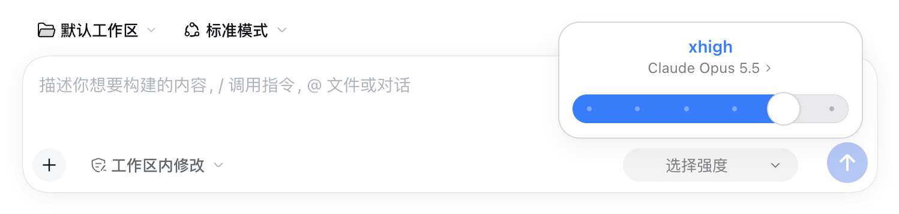
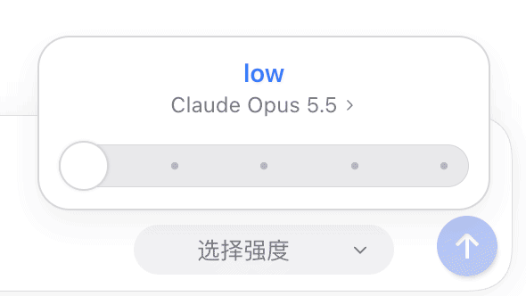
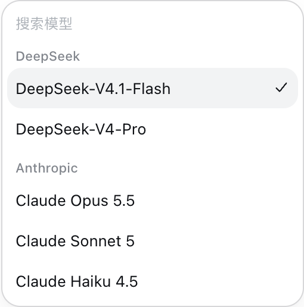
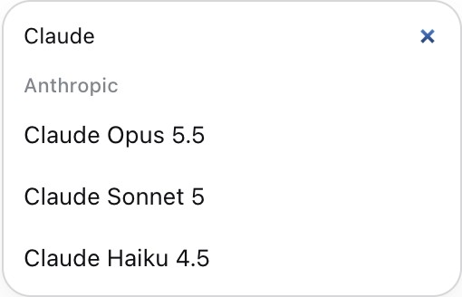
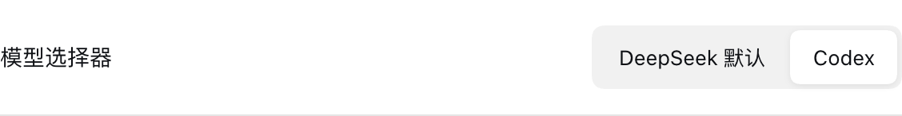
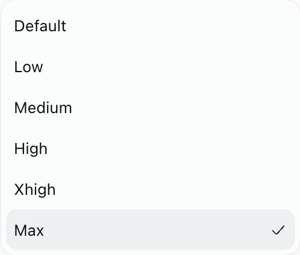
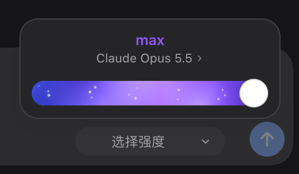

<div align="center">

# DSH Codex Picker

为 [DeepSeek Harness](https://github.com/deepseek-ai/deepseek-harness) 添加 Codex 风格的模型与思考强度选择器。

[](https://github.com/deepseek-harness-plugins/dsh-codex-picker)
[](docs/VERIFICATION.md)
[](LICENSE)

[界面预览](#界面预览) · [安装](#安装) · [使用](#使用) · [开发](#开发) · [贡献](#贡献)

</div>

<p align="center">
  
</p>

## 界面预览

### 用滑杆切换思考强度

点击输入框中的模型名称，直接点击档位或拖动滑块。档位保留模型原有的英文值，最高可用档位显示持续流动的紫色渐变与漂移粒子。

<p align="center">
  
</p>

滑块切档有吸附动画，悬停时放大，拖动时显示拖动光标。菜单包含打开、关闭与面板切换动画；最高档位的粒子扩散只在切入时播放，不额外添加 Ultra 档位。

### 在同一菜单中切换模型

点击滑杆面板中的模型名称进入模型列表，选中支持思考强度的模型后，菜单收缩回滑杆。模型下方显示渠道名称，较长的列表支持搜索，标题与搜索框保持固定。

<table>
  <tr><th>模型与渠道</th><th>搜索模型</th></tr>
  <tr>
    <td align="center"></td>
    <td align="center"></td>
  </tr>
</table>

### 选择自己习惯的样式

在 **设置 → 通用设置 → 模型选择器** 中切换 **DeepSeek 默认 / Codex**。首次安装使用 DeepSeek 默认样式。

<p align="center">
  
</p>

<table>
  <tr><th>DeepSeek 默认</th><th>Codex · 深色主题</th></tr>
  <tr>
    <td align="center"></td>
    <td align="center"></td>
  </tr>
</table>

## 安装

在 DSH 插件列表中显示为「Codex 模型选择器」。

需要 Node.js **≥ 22.19.0**，已验证的 DSH 版本为 **0.2.1-rc.2**。

```sh
git clone https://github.com/deepseek-harness-plugins/dsh-codex-picker.git
cd dsh-codex-picker
npm ci
npm run build
npm pack
```

打开 DSH 的 **插件 → 添加插件**，输入生成的 `.tgz` 安装包的绝对路径，安装并启用插件。升级时在插件详情中卸载旧版，再安装新版安装包；选择器样式偏好会保留。

## 使用

| 操作 | 效果 |
| --- | --- |
| 点击输入框中的模型名称 | 打开思考强度滑杆；无思考档位的模型直接打开模型列表。 |
| 点击档位或拖动滑块 | 切换当前会话的思考强度。 |
| 点击面板中的模型名称 | 展开模型列表，支持按模型或渠道搜索。 |
| 按 Escape | 模型列表返回滑杆；滑杆面板关闭并恢复入口焦点。 |
| 切换到 DeepSeek 默认或禁用插件 | 恢复 DSH 原生选择器。 |

插件读取 DSH 的模型目录与实际档位，沿用宿主的会话切换接口。`off` 明确关闭思考，`Default` 沿用提供商默认行为；只显示当前模型已有的档位。

在 DSH 0.2.1-rc.2 中，可通过 **设置 → 模型 → 编辑提供商 → 自定义设置 → 模型选项 → 推理等级** 增删档位并设置对应的 API 参数值。本插件直接读取这些原生配置，无需安装其他思考强度插件。

旧版 DSH Model Efforts 已归档。选择器仍保留旧版样式偏好的迁移，之后独立保存界面设置。

## 开发

```sh
npm ci
npm run build     # 构建插件
npm test          # 模型目录读取与偏好测试
npm run test:ui   # 独立选择器的页面和交互测试
npm run check    # 执行全部检查
```

页面测试使用隔离 DSH web profile 与本地模拟服务，需要已安装的 DSH CLI 与 Chrome。可通过 `DCP_CLI` 指定 CLI 路径，通过 `DCP_BROWSER` 指定 Playwright 浏览器通道。

最新版兼容修复见 [兼容性说明](docs/COMPATIBILITY.md)。宿主接口、交互参数及历史验证结果见 [验证记录](docs/VERIFICATION.md)。

## 贡献

欢迎通过 [Issue](https://github.com/deepseek-harness-plugins/dsh-codex-picker/issues) 反馈问题，或提交 Pull Request。

选择器交互位于 `src/picker.jsx`，模型与档位读取位于 `src/picker-model.js`，样式位于 `src/styles.css`。行为变更请补充相应测试。

提交信息遵循 [Conventional Commits](https://www.conventionalcommits.org/zh-hans/v1.0.0/)，仓库维护约定见 [AGENTS.md](AGENTS.md)。

## 许可证

[MIT](LICENSE)
