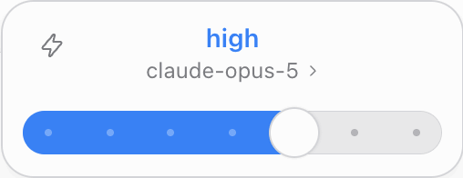
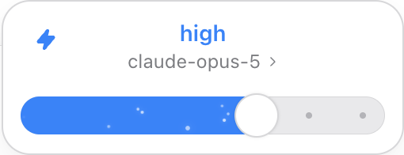

# 验证记录

## 2026-10-20 连续渐变过渡 0.1.8

0.1.7 在开关切换时重建粒子节点，并用固定起点播放回位动画。连续点击时，最高档漂浮粒子可在相邻两帧间从完全可见直接变为透明。移除随开关变化的节点 key，保留粒子路径和渐变画布；漂浮粒子和普通档圆点均从当前状态过渡，仅在完全不可见时重设右侧回位起点。

新增普通档与最高档的逐帧检查，覆盖 100ms 间隔的反复切换、正常淡出回位，以及粒子和画布节点连续性。README 实录动图的循环末尾使用淡化衔接，避免回到开头时硬切渐变背景。

构建、10 项逻辑测试、选择器状态测试、两组逐帧检查和隔离 DSH 0.2.1-rc.2 页面测试通过。本次最高档检查中，相邻采样帧的漂浮粒子透明度最大变化从旧版的 1 降至约 0.05；粒子层、运动路径与渐变画布保持同一节点。

## 2026-10-20 加速开启时的左端粒子 0.1.7

旧版使用当前滑块位置初始化粒子相位，最高档开启时粒子全从右端出发，左端需要等待第一批粒子穿过轨道。改为预先分布整条轨道的运动相位，开启时左端已有流动粒子，保留 1.9 秒基准周期、14 个粒子与原有淡入／淡出和最高档交接。

新增普通档和最高档的界面回归检查：将粒子动画定位到开启后 250ms，确认轨道左侧四分之一区域存在可见粒子。旧版在该检查中失败，修复后通过。构建、10 项逻辑测试、选择器状态测试和隔离 DSH 0.2.1-rc.2 页面测试通过，模型保存与请求参数检查保持通过。

## 2026-10-20 加速动画对照修正 0.1.6

对照本机 Codex 的界面资源，重做闪电开关的整轨道单向粒子、圆点离场／回位、最高档粒子交接和按钮尺寸。具体时序见 [加速动效对照](fast-animation-parity.md)。

构建、10 项逻辑测试、选择器状态测试与隔离 DSH 0.2.1-rc.2 页面测试通过。逐帧确认粒子从右向左匀速穿越完整轨道；重新打开菜单跳过开启动画；普通档和最高档分别显示蓝色、紫色闪电；关闭后原有圆点和最高档漂浮粒子恢复。模型保存接口调用、配置文件和请求参数检查保持通过。

## 2026-10-20 加速动效 0.1.5

宿主：DeepSeek Harness 0.2.1-rc.2。构建、10 项逻辑测试、选择器状态测试与隔离 DSH 页面测试通过。

- 左上角闪电支持点击和键盘切换；开启后变为蓝色实心图标，轨道粒子加速漂移，并限制在已填充区域内。
- 闪电不调用宿主模型选择接口、不写入模型配置，不改变模型或档位；本地模拟请求没有增加 `service_tier`。
- 菜单关闭重开、切换模型后保留动效开关；最高档切换闪电不重复气泡扩散，关闭闪电后仍保留原有紫色渐变和粒子。
- 闪电开关不改变菜单位置和尺寸；减少动态效果时停止粒子动画。
- 滑杆打开时，固定宽度入口显示「选择推理强度」；模型菜单继续显示模型名称和档位。

## 2026-10-18 分组列表更新

宿主：DeepSeek Harness 0.2.1-rc.2。构建、10 项逻辑测试、选择器状态测试与真实 DSH 页面测试通过。

模型按原生顺序展示来源标题与单行模型，直接显示模型目录名称，保留选中背景和勾选，不附加 DSH 临时版本徽标。验证跨来源键盘导航、同名模型区分、来源搜索、空分组移除、深色与窄窗口布局，以及原有思考强度请求与原生样式恢复。

以下为此前版本的验证记录。

日期：2026-10-12。插件：0.1.0。宿主：DeepSeek Harness 0.2.0-rc.2。

## 自动验证

构建和 6 项逻辑测试通过。选择器状态测试、独立安装的 DSH 页面测试，以及与 DSH Model Efforts 0.5.0 同时安装的联合页面测试通过。

- 从宿主读取实际模型档位，区分渠道，保留 `off / Default` 语义并排除 Ultra。
- 通用设置只显示 DeepSeek 默认 / Codex 样式选项；首次安装保留原生样式。
- 独立安装时直接使用宿主档位，无档位的模型打开模型列表。
- 选择 `low / max / xhigh` 的请求传递对应 `output_config.effort`；选择 `off` 传递 `thinking.type = "disabled"`。
- 样式开关不改写模型配置，页面重载保留偏好，禁用插件恢复原生选择器。
- 新偏好优先、旧版样式继承，以及两个插件存储互不覆盖。
- 宿主 pending 清除后延迟更新目录时，滑杆保留刚选择的档位；标题与面板节点保持一致，亮度不闪动。请求失败回退到实际档位并显示错误。
- 菜单打开、关闭、面板切换、键盘操作、光标反馈、窄窗口、深色主题与减少动态效果。
- 固定标题与搜索框，模型列表内部滚动且隐藏滚动条；模型下方显示渠道，支持模型与渠道搜索。
- 联合安装时读取编辑器配置的档位与默认值；单独禁用档位插件后选择器仍可使用。
- 测试过程中没有页面异常。

页面请求使用本地模拟 Anthropic 服务，不需要厂商 API 密钥。

## 界面与动画

尺寸与动画时序参考本机 Codex 客户端的模型选择器资源，菜单和滑杆由本项目独立实现。

| 项目 | 参数 |
| --- | --- |
| 面板宽度 / 最大高度 | 254px / 360px |
| 滑杆 / 模型菜单圆角 | 18px / 16px |
| 轨道高度 / 滑块直径 | 24px / 28px |
| 滑块悬停直径 | 32px，弹性过渡 |
| 点击或键盘切档 / 拖动 | 300ms / 150ms |
| 打开菜单 | 320ms，延迟 30ms |
| 关闭菜单 | 140ms 淡出收缩，之后卸载 |
| 面板切换 | 320ms 高度过渡，底边固定 |
| 最高档位 | 持续流动的紫色明暗层、14 个漂移粒子；切入时 16 个粒子扩散一次 |

思考强度面板打开时，入口显示固定宽度的“选择强度”；模型列表中显示模型名称与档位。点击或拖动切档不会改变菜单锚点。选中支持思考强度的模型后，菜单收缩回滑杆。

滑块悬停和档位圆点使用 pointer，拖动时为 grabbing，搜索框为 text。最高档位重新打开不重复粒子扩散；减少动态效果时关闭动画。

## 兼容范围

选择器使用官方 `conversation.input.model` 和 `settings.general.item` 插槽，沿用宿主 ModelDirectory 与会话切换接口。兼容性验证基于 DSH 0.2.0-rc.2。

本插件独立读取宿主能力，不维护模型规则或修改提供商请求适配器。模型档位配置可由宿主或独立的 DSH Model Efforts 插件提供。

选择器样式保存在当前客户端的 localStorage；旧版 DSH Model Efforts 的 `pickerStyle` 偏好会继续沿用。
